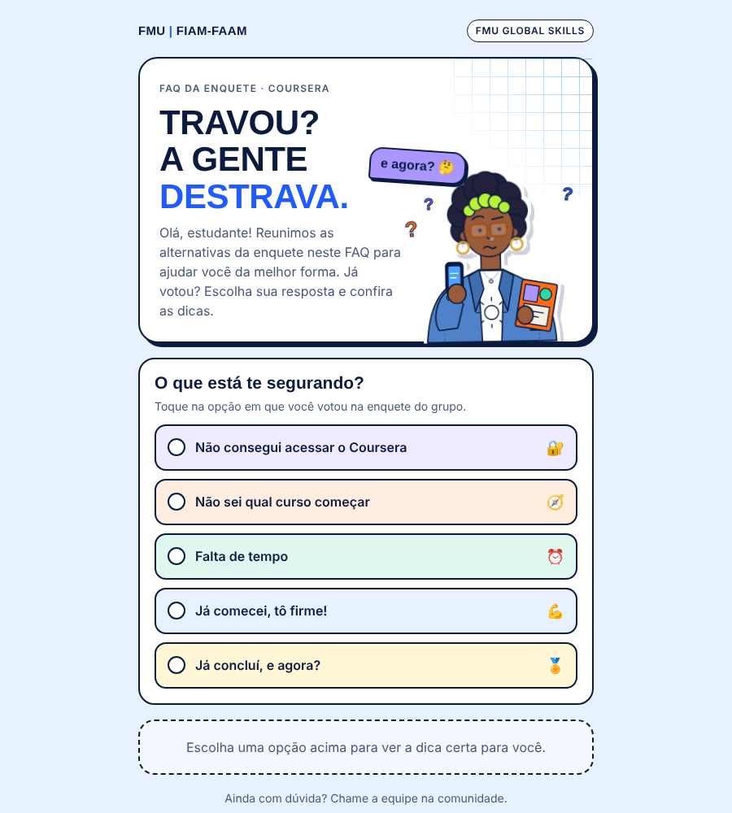
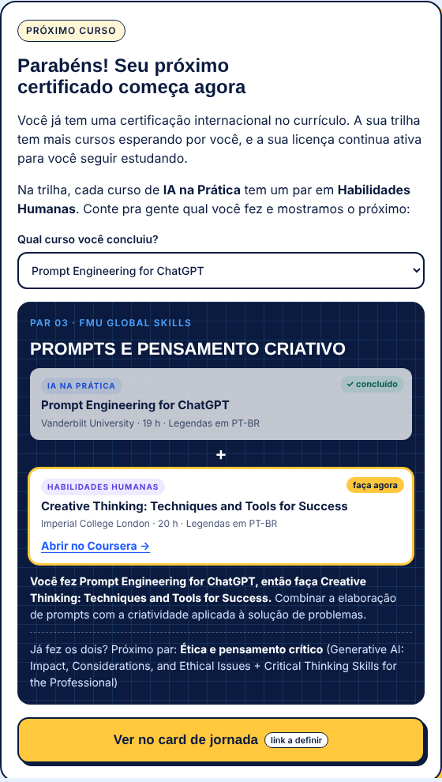

# FAQ interativo · FMU Global Skills

Página criada para reengajar estudantes do programa de certificações internacionais 
**FMU Global Skills** (parceria FMU | FIAM-FAAM + Coursera), compartilhada na comunidade de WhatsApp do programa.

Cada opção da enquete enviada no grupo vira uma resposta com uma ação concreta: 
o estudante toca no que votou e recebe a dica certa.

 

## O que a página faz

| Resposta da enquete | O que o estudante recebe |
|---|---|
| Não consegui acessar o Coursera | Vídeo passo a passo e o assunto do e-mail de convite para copiar com um toque |
| Não sei qual curso começar | Atalho para o quiz de skills, que indica um curso de IA e um de Habilidades Humanas |
| Falta de tempo | Escolha de horas por semana e sugestão de cursos da trilha com a duração ideal para esse ritmo |
| Já comecei, tô firme! | Incentivo, certificado no LinkedIn e card de jornada |
| Já concluí, e agora? | "Você fez X, então faça Y": mostra o par do curso concluído (IA na Prática + Habilidades Humanas) e o próximo par da trilha |

 

## Destaques

- **HTML, CSS e JavaScript puros**, em um único arquivo, sem dependências nem build. Pronto para hospedar em S3 ou GitHub Pages.
- **Ilustração em SVG animada** em loop: a personagem passa da dúvida ("e agora?") para a dúvida resolvida ("consegui!").
- **Links diretos para cada resposta** com âncoras (`#acesso`, `#comecar`, `#tempo`, `#firme`, `#concluiu`), para a equipe responder dúvidas no grupo com o link exato.
- **Dados da trilha** (15 pares, carga horária e idioma de cada curso) organizados em um array no próprio arquivo.
- Pensada para celular, acessível por teclado e respeitando `prefers-reduced-motion`.

 

## Dados protegidos

Esta é a versão de portfólio. Os links internos foram substituídos por campos vazios ou exemplos:

- convite da comunidade de WhatsApp;
- vídeo de acesso;
- quiz e card de jornada;
- slug do programa e IDs das coleções no Coursera (`SEU-PROGRAMA`, `ID_COLECAO_IA`, `ID_COLECAO_HUMANAS`).

Os botões sem link aparecem marcados como "link a definir". Para usar, preencha o objeto `LINKS` e as constantes `PROG`, `SLUG_IA` e `SLUG_HUM` no início do `<script>`.

 

## Como rodar

Abra o `index.html` no navegador. Não precisa instalar nada.

 

---

Projeto desenvolvido por [Jéssica Maciel](https://www.linkedin.com/in/jessicamaciels/) · Educação Digital e Novos Produtos

