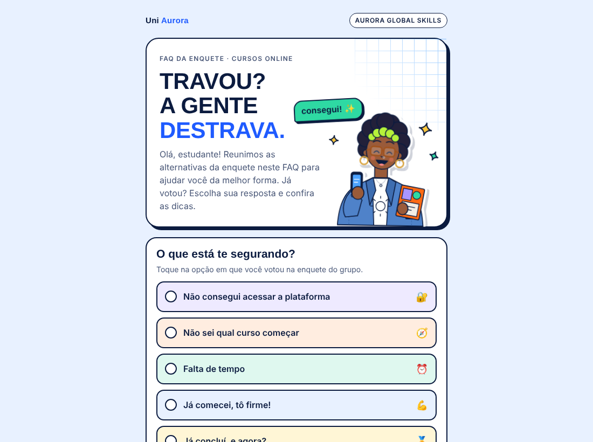

<div align="center">

# FAQ interativa · Travou? A gente destrava.

Página de dúvidas frequentes que transforma cada resposta de uma enquete de WhatsApp<br>
em uma ação concreta: o estudante toca no que votou e recebe a dica certa para seguir nos cursos.


### [▶ Ver a página no ar](https://jemacieldev.github.io/faq-interativa/)



</div>

> **Sobre esta versão.** O projeto original foi desenvolvido em contexto profissional. Este repositório é uma versão demonstrativa: a estrutura e a lógica são as mesmas, mas a instituição "Uni Aurora", o programa e os cursos são fictícios, e os links externos foram removidos.

<div align="center">

## Contexto

</div>

Uma instituição de ensino oferece um programa de certificações internacionais, com uma comunidade no WhatsApp para acompanhar os estudantes. Muitos se inscreviam, mas não começavam os cursos ou paravam depois do primeiro.

Para entender o motivo, a equipe enviou uma enquete no grupo: "O que está te segurando?". O engajamento melhorou já com a enquete, e as respostas mostraram onde cada estudante travava: no acesso, na escolha do curso, no tempo ou no que fazer depois de concluir.

<div align="center">

## A ideia

</div>

Em vez de uma lista de perguntas e respostas, a FAQ repete as opções da enquete. O estudante toca na opção em que votou e recebe uma resposta curta que sempre termina em uma ação: assistir ao vídeo, fazer o quiz, escolher um curso que cabe na semana ou começar o próximo da trilha.

| Resposta da enquete | O que o estudante recebe |
|---|---|
| Não consegui acessar a plataforma | Vídeo passo a passo e o assunto do e-mail de convite para copiar com um toque |
| Não sei qual curso começar | Atalho para o quiz de skills, que indica um curso de IA e um de Habilidades Humanas |
| Falta de tempo | Escolha de horas por semana e cursos da trilha com a duração ideal para esse ritmo |
| Já comecei, tô firme! | Incentivo, certificado no LinkedIn e card de jornada |
| Já concluí, e agora? | "Você fez X, então faça Y": o par do curso concluído e o próximo par da trilha |

<div align="center">

## Meu papel

</div>

- **Concepção:** propus transformar o resultado da enquete em uma FAQ que leva cada estudante a uma ação.
- **Conteúdo:** organizei as respostas a partir do FAQ da equipe e defini o que cada uma deveria entregar.
- **Curadoria:** usei os pares da trilha (um curso de IA + um de Habilidades Humanas) para recomendar o próximo curso e as opções por tempo disponível.
- **Direção visual:** defini a identidade alinhada aos quizzes do programa e a personagem que passa da dúvida para a dúvida resolvida.
- **Página:** acompanhei a construção até a publicação, com apoio de IA no desenvolvimento do código.

<div align="center">

## Como funciona

</div>

- **Uma resposta por vez.** Tocar em uma opção mostra só a resposta dela e rola a página até ela.
- **Link direto para cada resposta.** `#acesso`, `#comecar`, `#tempo`, `#firme` e `#concluiu` abrem a resposta certa, o que permite à equipe responder dúvidas no grupo com o link exato.
- **Sugestão por tempo disponível.** O estudante escolhe quantas horas tem por semana (1, 2, 3 ou 5+) e a página mostra os cursos da trilha na faixa de duração certa, com a previsão de semanas para terminar.
- **Próximo curso pelo par.** O estudante escolhe o curso que concluiu e vê o par dele, com o "por que juntos" e o próximo par da trilha.
- **Ilustração em SVG animada.** A personagem alterna em loop entre a dúvida ("e agora?") e a dúvida resolvida ("consegui!"), mudando a expressão do rosto.
- **Copiar com um toque.** O assunto do e-mail de convite é copiado para a área de transferência, para o estudante colar na busca do e-mail.
- **Conteúdo separado da lógica.** Links e pares da trilha ficam em `faq-data.js`. Os botões sem link aparecem como "link a definir", e o botão do curso só aparece quando há link.
- **Acessibilidade.** Botões com `aria-pressed`, resultados anunciados com `aria-live`, foco visível e animações desativadas para quem usa `prefers-reduced-motion`.

<div align="center">

## Tecnologias

</div>

HTML, CSS e JavaScript puro, sem bibliotecas nem etapa de build. A versão original está hospedada na AWS (S3).

```
index.html     estrutura da página e ilustração em SVG
styles.css     estilos, com as cores em variáveis no :root
faq-data.js    conteúdo: links dos botões e pares da trilha
script.js      respostas, sugestões por tempo, par do curso e eventos
```

<div align="center">

## Como rodar

</div>

Acesse [jemacieldev.github.io/faq-interativa](https://jemacieldev.github.io/faq-interativa/) ou baixe a pasta e abra o `index.html` no navegador. Não é preciso instalar nada.

<div align="center">

## Próximos passos

</div>

- Contar os cliques em cada resposta para saber onde os estudantes mais travam.
- Gerar as opções da enquete a partir dos dados, como já acontece com os pares.

<div align="center">

---

Desenvolvido por [Jéssica Maciel](https://www.linkedin.com/in/jessicamaciels/).

</div>
